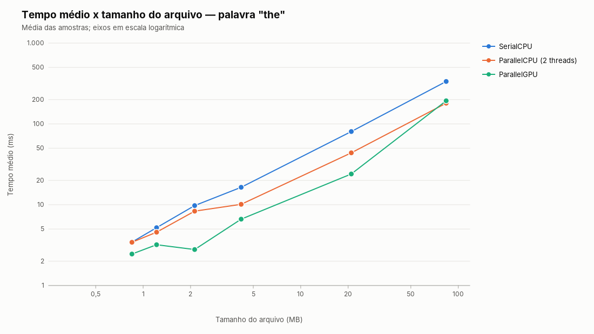
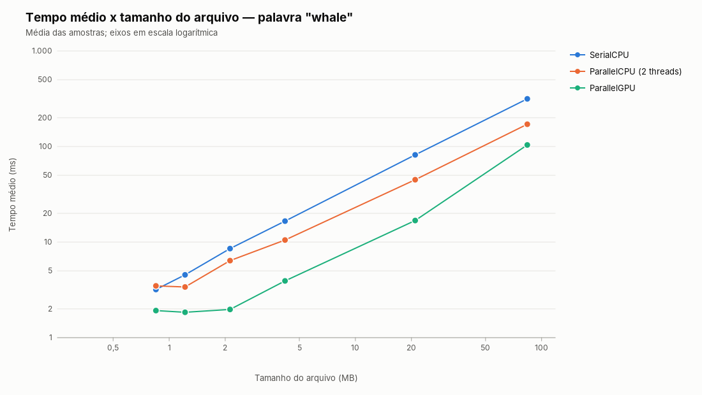
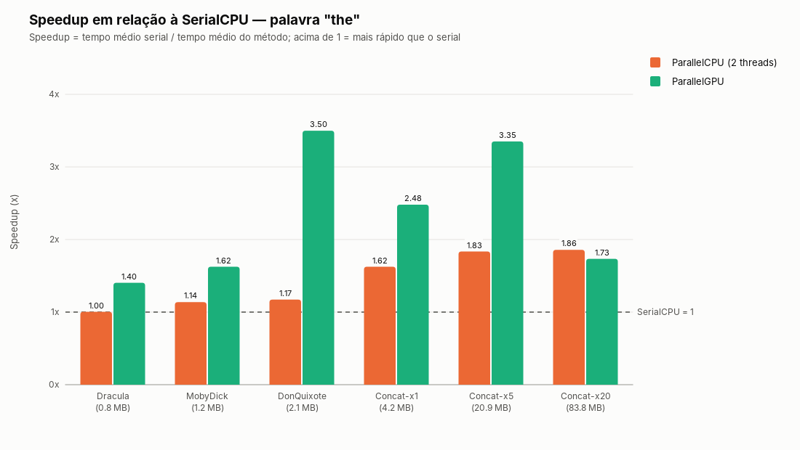
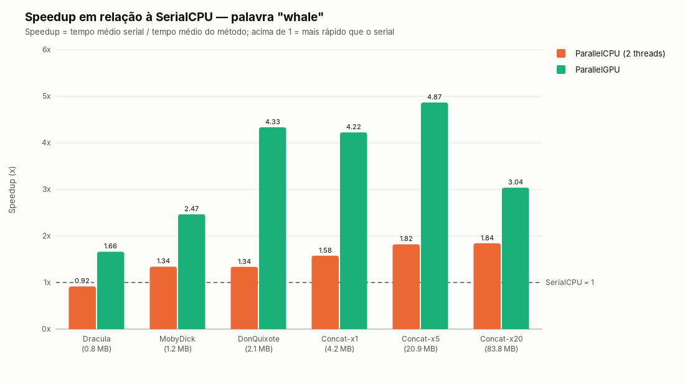
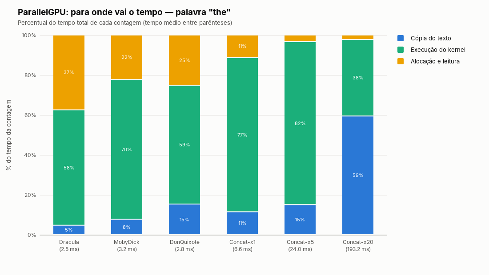
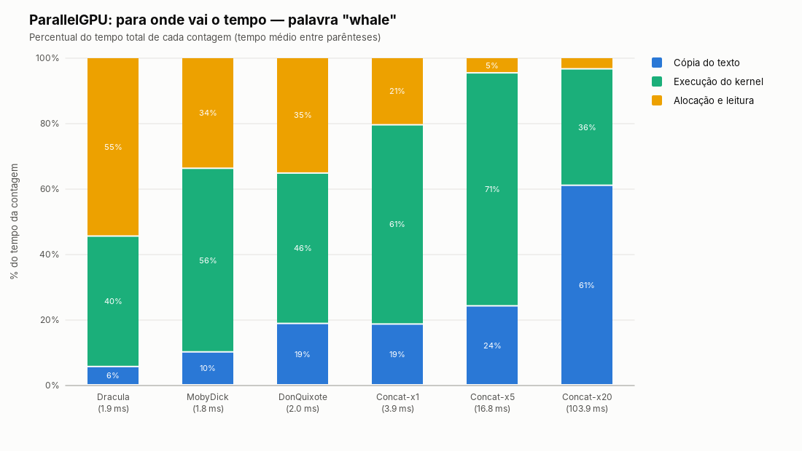
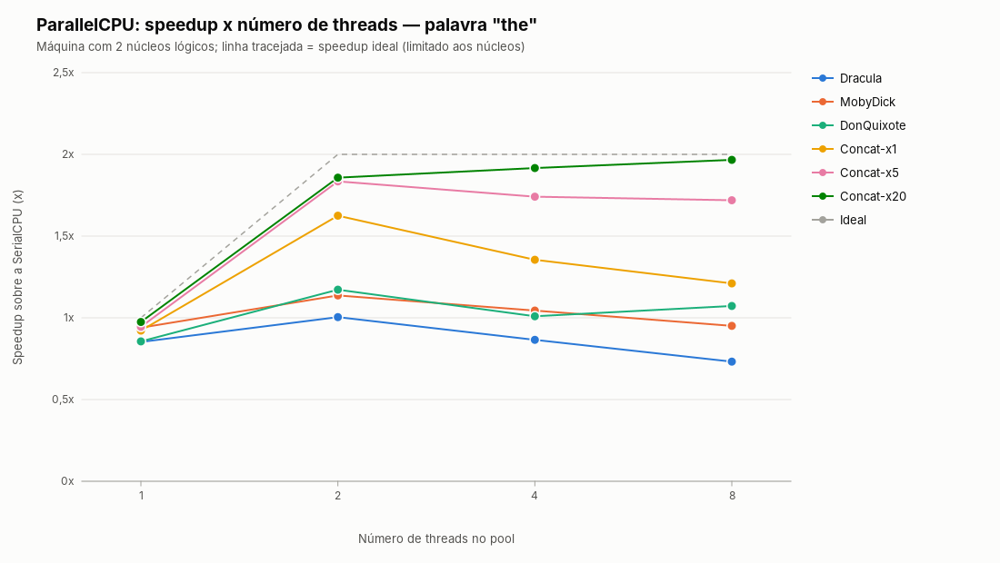
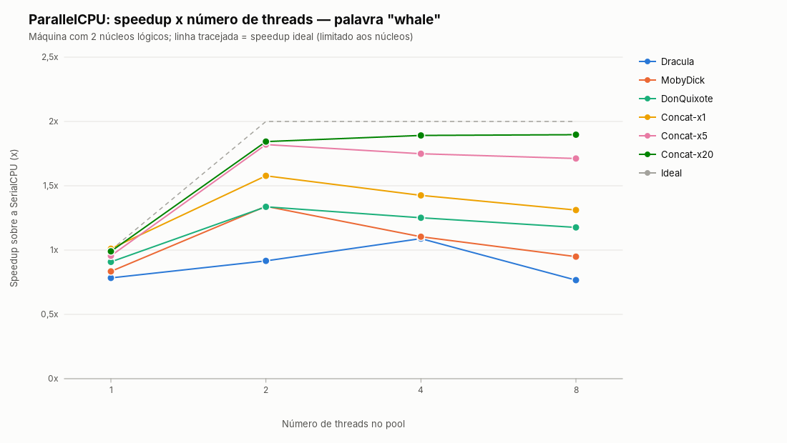

# Análise comparativa de algoritmos com uso de paralelismo

**Disciplina:** Computação Paralela e Concorrente — UNIFOR\
**Professor:** Izequiel Pereira de Norões\
**Dupla:** Lucas de Vasconcelos Barreira Carvalho (matrícula 2410424) (matrícula - 2410424)
**Repositório:** https://github.com/Lucasvbc-Dev/computacao-paralela

---

## Resumo

Este trabalho compara o desempenho de três implementações em Java de um algoritmo de busca que conta quantas vezes uma palavra aparece em um texto: uma versão serial na CPU (**SerialCPU**), uma versão paralela na CPU com pool de threads (**ParallelCPU**) e uma versão paralela com OpenCL através da biblioteca JOCL 2.0.4 (**ParallelGPU**). Foi construído um framework de testes que executa os três métodos sobre seis arquivos de 0,85 MB a 83,8 MB (os três livros da amostra e arquivos maiores gerados a partir deles), com duas palavras de frequências diferentes ("the" e "whale"), quatro configurações de threads (1, 2, 4 e 8) e 10 amostras por configuração, após 3 execuções de aquecimento. Os tempos foram gravados em CSV e analisados estatisticamente (média, desvio padrão, coeficiente de variação, intervalo de confiança de 95%, speedup e eficiência). Os três métodos encontraram exatamente a mesma contagem em todos os casos. A versão serial foi a mais lenta em praticamente todos os cenários; a ParallelCPU com 2 threads chegou a 1,86x de speedup nos arquivos grandes (eficiência de 0,93 com 2 núcleos), e a ParallelGPU (OpenCL) chegou a 4,87x. Em arquivos pequenos o custo de criar threads e de preparar o dispositivo pesa mais, e os ganhos diminuem.

## Introdução

A contagem de ocorrências de uma palavra é um problema simples, mas de natureza muito paralelizável: o texto pode ser dividido em pedaços independentes e o resultado final é a soma das contagens parciais (padrão *map-reduce*). Isso o torna um bom caso para comparar processamento serial e paralelo em CPU e em GPU.

### Regra de contagem (igual nos três métodos)

- A busca não diferencia maiúsculas de minúsculas (o texto e a palavra são convertidos para minúsculas).
- Conta-se a **palavra inteira**: "the" não é contada dentro de "there" ou "other".
- São caracteres de palavra as letras e dígitos do Latin-1 (`a-z`, `0-9`, `À-ÿ`). Todo o resto (espaço, pontuação, apóstrofo, sublinhado, quebra de linha) é separador. Assim, "whale's" conta como "whale".

A leitura do arquivo e a conversão para minúsculas são feitas uma vez, **fora** da medição de tempo, para que os três métodos meçam apenas a contagem.

### Métodos implementados

| Método | Classe | Abordagem |
|---|---|---|
| SerialCPU | `SerialCPU.java` | Um loop simples percorre o texto palavra por palavra e compara cada uma com a palavra buscada. |
| ParallelCPU | `ParallelCPU.java` | Um pool de threads (`Executors.newFixedThreadPool`) divide o texto em N partes; cada thread conta na sua parte com o mesmo loop da versão serial e as contagens parciais são somadas. As fronteiras entre as partes são empurradas até um separador, para nenhuma palavra ser cortada ao meio. |
| ParallelGPU | `ParallelGPU.java` | OpenCL via JOCL. O texto é copiado para a memória do dispositivo e cada *work-item* verifica um bloco de 64 posições: se em uma posição começa a palavra buscada (com separador antes e depois), conta 1. Primeiro compara-se só a primeira letra (filtro barato), depois o restante. Cada *work-item* faz no máximo um `atomic_add` no contador global. |

A saída de cada método é a contagem e o tempo de execução, no formato pedido:

```
SerialCPU: 1244 ocorrências em 4 ms
ParallelCPU: 1244 ocorrências em 3 ms
ParallelGPU: 1244 ocorrências em 2 ms
```

## Metodologia

### Framework de teste

A classe `Benchmark.java` automatiza todos os testes:

1. **Conjuntos de dados.** Usa os três arquivos da amostra e gera arquivos maiores concatenando os três livros e repetindo o resultado 1, 5 e 20 vezes. São seis entradas com tamanhos de 0,85 MB a 83,8 MB e de naturezas diferentes: dois livros em inglês (Dracula, Moby Dick) e um em espanhol (Don Quijote).
2. **Palavras.** "the" (muito frequente em inglês e quase ausente no texto em espanhol) e "whale" (frequente só em Moby Dick).
3. **Configurações.** SerialCPU; ParallelCPU com 1, 2, 4 e 8 threads; ParallelGPU.
4. **Aquecimento.** Antes das medições, cada método roda 3 vezes sem registro, para que o compilador JIT da JVM e o driver OpenCL já estejam prontos. Sem isso a primeira execução mede compilação, não o algoritmo.
5. **Amostras.** 10 amostras por configuração (o mínimo pedido é 3). As amostras são intercaladas (serial, paralelas, GPU, serial, ...) para que qualquer variação da máquina ao longo do tempo afete todos os métodos de forma igual.
6. **Validação.** O framework confere se todos os métodos encontraram a mesma contagem; se não, o teste é interrompido.
7. **Medição.** `System.nanoTime()` em volta de cada chamada. Na ParallelGPU, o tempo inclui criar os buffers, copiar o texto para o dispositivo, executar o kernel e ler o resultado. A preparação do OpenCL (escolher dispositivo, criar contexto e compilar o kernel) acontece uma única vez por execução do programa e é medida à parte. Com *profiling* do OpenCL também se registram separadamente o tempo de cópia e o tempo do kernel.

### Registro dos dados (CSV)

| Arquivo | Conteúdo |
|---|---|
| `resultados/resultados_brutos.csv` | Uma linha por execução: palavra, arquivo, tamanho, método, threads, nº da amostra, ocorrências, tempo (ms), tempo do kernel e tempo de cópia (GPU). 720 execuções. |
| `resultados/resumo.csv` | Uma linha por configuração, com as estatísticas abaixo. |
| `resultados/ambiente.txt` | Máquina, sistema, versão do Java, dispositivo OpenCL e parâmetros do teste. |

### Análise estatística

Para cada configuração (palavra, arquivo, método, threads) foram calculados:

- **Média** e **desvio padrão amostral** (n − 1) dos 10 tempos;
- **Coeficiente de variação** (CV = desvio / média), para avaliar a estabilidade da medição;
- **Mínimo** e **máximo**;
- **Intervalo de confiança de 95%** da média, com a distribuição t de Student (t = 2,262 para 9 graus de liberdade);
- **Speedup** = tempo médio da SerialCPU / tempo médio do método;
- **Eficiência** (ParallelCPU) = speedup / nº de núcleos efetivamente usados (mínimo entre threads e núcleos).

### Ambiente de execução

| Item | Valor |
|---|---|
| Processador | Intel Xeon (Skylake, AVX-512) @ 2,10 GHz, **2 núcleos lógicos** |
| Memória da JVM | 3 GB (`-Xmx3g`) |
| Sistema | Linux 6.18 (x86_64) |
| Java | OpenJDK 21 |
| OpenCL | PoCL 5.0 (*Portable Computing Language*) |
| Dispositivo OpenCL | a própria CPU (não havia placa de vídeo na máquina de teste) |

**Observação importante:** a máquina usada nesta bateria não tinha GPU física. O programa procura primeiro um dispositivo OpenCL do tipo GPU e, quando não encontra, usa o primeiro dispositivo OpenCL disponível — aqui, a CPU através do PoCL, que executa o mesmo kernel vetorizando os *work-items* com instruções SIMD (AVX-512). O código é o mesmo que roda numa GPU; para medir em uma placa de vídeo basta executar `run.bat benchmark` (ou `./run.sh benchmark`) numa máquina que tenha uma, e os CSV e gráficos são gerados de novo.

## Resultados e Discussão

### Tempos médios e speedup

Tempo médio ± desvio padrão de 10 amostras, em milissegundos. A ParallelCPU está com 2 threads (= núcleos da máquina).

**Palavra "the"**

| Arquivo | MB | Ocorrências | SerialCPU | ParallelCPU (2T) | ParallelGPU | Speedup CPU | Speedup GPU |
|---|---:|---:|---:|---:|---:|---:|---:|
| Dracula | 0,85 | 8.104 | 3,44 ± 0,69 | 3,43 ± 0,87 | 2,45 ± 0,49 | 1,00x | 1,40x |
| MobyDick | 1,22 | 14.727 | 5,20 ± 2,00 | 4,57 ± 1,24 | 3,20 ± 0,53 | 1,14x | 1,62x |
| DonQuixote | 2,12 | 188 | 9,75 ± 1,76 | 8,32 ± 2,44 | 2,79 ± 0,66 | 1,17x | 3,50x |
| Concatenado-x1 | 4,19 | 23.019 | 16,43 ± 1,21 | 10,11 ± 1,04 | 6,62 ± 1,14 | 1,62x | 2,48x |
| Concatenado-x5 | 20,95 | 115.095 | 80,46 ± 7,15 | 43,85 ± 3,16 | 24,01 ± 2,78 | 1,83x | 3,35x |
| Concatenado-x20 | 83,78 | 460.380 | 335,05 ± 19,22 | 180,38 ± 17,70 | 193,24 ± 103,86 | 1,86x | 1,73x |

**Palavra "whale"**

| Arquivo | MB | Ocorrências | SerialCPU | ParallelCPU (2T) | ParallelGPU | Speedup CPU | Speedup GPU |
|---|---:|---:|---:|---:|---:|---:|---:|
| Dracula | 0,85 | 1 | 3,19 ± 0,18 | 3,48 ± 2,07 | 1,92 ± 1,18 | 0,92x | 1,66x |
| MobyDick | 1,22 | 1.244 | 4,54 ± 0,58 | 3,39 ± 1,00 | 1,84 ± 0,40 | 1,34x | 2,46x |
| DonQuixote | 2,12 | 0 | 8,55 ± 0,82 | 6,40 ± 1,67 | 1,97 ± 0,44 | 1,34x | 4,33x |
| Concatenado-x1 | 4,19 | 1.245 | 16,58 ± 1,94 | 10,51 ± 2,36 | 3,93 ± 0,53 | 1,58x | 4,22x |
| Concatenado-x5 | 20,95 | 6.225 | 81,82 ± 5,05 | 44,95 ± 5,20 | 16,82 ± 3,58 | 1,82x | 4,87x |
| Concatenado-x20 | 83,78 | 24.900 | 315,49 ± 17,75 | 171,14 ± 9,32 | 103,89 ± 22,97 | 1,84x | 3,04x |





O tempo da SerialCPU cresce de forma praticamente linear com o tamanho do arquivo (cerca de 4 ms por MB), como esperado para um algoritmo O(n). As duas versões paralelas ficam abaixo da serial em quase todos os pontos.





**Efeito do tamanho da entrada.** Nos arquivos pequenos (0,85 a 2,1 MB) a contagem dura poucos milissegundos e o custo fixo do paralelismo — criar o pool de threads, dividir o texto, sincronizar — é da mesma ordem do próprio trabalho. Por isso a ParallelCPU fica entre 0,92x e 1,34x. Nesses casos o coeficiente de variação das versões paralelas chega a 60% e as diferenças não são estatisticamente significativas: por exemplo, no Dracula com "whale" a ParallelCPU (3,48 ± 2,07 ms) e a SerialCPU (3,19 ± 0,18 ms) têm intervalos de confiança que se sobrepõem. A partir de 4 MB o trabalho útil passa a dominar e a ParallelCPU se aproxima do limite de 2x imposto pelos 2 núcleos: 1,58x a 1,62x em 4 MB e 1,82x a 1,86x nos arquivos de 21 e 84 MB, que também têm as medições mais estáveis (CV abaixo de 12%).

**ParallelGPU (OpenCL).** Foi o método mais rápido em 11 dos 12 cenários, com speedup entre 1,40x e 4,87x. Dois fatores explicam: (1) o kernel compara primeiro só a primeira letra, descartando a maior parte das posições com uma única comparação, enquanto as versões em CPU examinam cada caractere para separar as palavras; e (2) o PoCL executa vários *work-items* ao mesmo tempo com instruções vetoriais AVX-512, aproveitando os 2 núcleos e o SIMD de cada um. A única exceção foi o maior arquivo com a palavra "the": 193 ms contra 180 ms da ParallelCPU — mas com desvio padrão de 104 ms, o que torna os dois estatisticamente empatados.

**Efeito da natureza dos dados.** A palavra buscada muda pouco o tempo das versões em CPU (elas percorrem todas as palavras de qualquer forma), mas muda bastante o da ParallelGPU: com "whale" o speedup foi maior do que com "the" em todos os arquivos (por exemplo, 4,87x contra 3,35x no Concatenado-x5), porque a letra "w" é bem menos comum que "t" e o filtro da primeira letra descarta mais posições. Pelo mesmo motivo, no texto em espanhol (Don Quijote, com só 188 ocorrências de "the") a GPU teve seu maior speedup com "the" (3,50x).





**Para onde vai o tempo da GPU.** Nos arquivos pequenos, 22% a 55% do tempo é custo fixo (alocar buffers, passar argumentos, ler o resultado), o que limita o ganho. Nos arquivos médios o kernel domina (61% a 82%). No maior arquivo (84 MB) a **cópia do texto** para a memória do dispositivo passa a ser a maior parte (cerca de 60%) e também a mais instável: é ela que causa o desvio padrão alto e a queda de speedup nesse ponto. Esse comportamento é típico de GPUs reais, onde a cópia atravessa o barramento PCIe: o processamento é rápido, mas os dados precisam chegar até a placa. Em aplicações reais, quando vários processamentos são feitos sobre o mesmo dado, o texto é copiado uma vez e reutilizado, e esse custo se dilui.

### Variação do número de threads (ParallelCPU)





Speedup e eficiência da ParallelCPU no maior arquivo (Concatenado-x20, palavra "the"):

| Threads | Tempo médio (ms) | Speedup | Eficiência |
|---:|---:|---:|---:|
| 1 | 343,76 | 0,97x | 0,97 |
| 2 | 180,38 | 1,86x | 0,93 |
| 4 | 174,84 | 1,92x | 0,96 |
| 8 | 170,38 | 1,97x | 0,98 |

- **1 thread** é quase sempre um pouco mais lenta que a SerialCPU (0,78x a 1,01x): é o mesmo trabalho mais o custo do pool. Isso mostra o *overhead* puro do paralelismo.
- **2 threads** (= núcleos da máquina) dão o maior ganho. Nos arquivos grandes a eficiência fica entre 0,91 e 0,93, ou seja, os núcleos são bem aproveitados.
- **4 e 8 threads** não aumentam o speedup de forma relevante, porque só existem 2 núcleos. Nos arquivos grandes o resultado fica entre 1,71x e 1,97x (no maior arquivo, dividir o texto em mais partes equilibra um pouco melhor a carga), mas nos arquivos pequenos piora (Dracula cai para 0,73x com 8 threads), porque criar e coordenar threads extras custa mais do que o trabalho de cada uma.

Esses resultados seguem a **Lei de Amdahl**: o ganho é limitado pela parte que não se paraleliza (criação do pool, divisão do texto, soma das parciais) e pelo número de núcleos físicos disponíveis.

## Conclusão

As três implementações produziram contagens idênticas em todas as 720 execuções medidas, o que valida a divisão do trabalho entre threads e entre *work-items*. A versão serial só não foi superada em arquivos muito pequenos, em que as diferenças ficaram dentro da margem de erro.

A ParallelCPU mostrou o comportamento clássico de paralelismo em memória compartilhada: speedup próximo do número de núcleos (1,86x com 2 núcleos, eficiência de 0,93) quando a entrada é grande, e pouco ou nenhum ganho quando a entrada é pequena ou quando há mais threads do que núcleos.

A ParallelGPU, com OpenCL, foi a mais rápida na maioria dos casos (até 4,87x), graças ao grande número de *work-items* independentes e a um kernel que descarta rapidamente as posições que não podem conter a palavra. Por outro lado, ela tem custos que as versões em CPU não têm: preparação do OpenCL (compilação do kernel, cerca de 650 ms, feita uma vez) e cópia dos dados para o dispositivo, que passou a dominar no maior arquivo.

Em resumo: para entradas pequenas, a versão serial é suficiente; para entradas médias e grandes, a paralela em CPU é a mais previsível; e o processamento em OpenCL/GPU compensa quando o volume de dados é grande e a preparação do dispositivo e a cópia dos dados podem ser amortizadas em várias buscas.

## Como executar

### Requisitos

- **JDK 17 ou superior** (o código usa `record`, `switch` com `->` e *text blocks*).
- **Biblioteca JOCL 2.0.4** — arquivo `jocl-2.0.4.jar`, **já incluído na pasta `lib/` do projeto**. Ele contém as bibliotecas nativas para Windows, Linux e macOS; não é preciso instalar nada além dele.
- **Driver OpenCL**: no Windows o `OpenCL.dll` vem com o driver da placa de vídeo (NVIDIA, AMD ou Intel). No Linux, instale o pacote `ocl-icd-libopencl1` e o driver/ICD do dispositivo (para usar a CPU como dispositivo OpenCL, sem placa de vídeo: `sudo apt install pocl-opencl-icd ocl-icd-opencl-dev`).

### Estrutura

```
contagem-palavras-paralela/
├── amostras/                  textos de entrada (Dracula, MobyDick, DonQuixote)
│   └── geradas/               arquivos maiores criados pelo benchmark (não versionados)
├── lib/
│   └── jocl-2.0.4.jar         <-- biblioteca JOCL (deve ficar aqui)
├── resultados/
│   ├── resultados_brutos.csv
│   ├── resumo.csv
│   ├── ambiente.txt
│   └── graficos/*.png
├── src/br/unifor/paralela/    código-fonte
├── run.bat                    compilar e executar no Windows
└── run.sh                     compilar e executar no Linux/macOS
```

### Comandos

Os scripts compilam o projeto com a JOCL no classpath e executam:

```
run.bat contar amostras\MobyDick-217452.txt whale     (Windows)
./run.sh contar amostras/MobyDick-217452.txt whale    (Linux/macOS)
```

| Comando | O que faz |
|---|---|
| `contar <arquivo.txt> <palavra>` | Executa SerialCPU, ParallelCPU e ParallelGPU uma vez e mostra contagem e tempo. |
| `benchmark` | Bateria completa: gera os arquivos maiores, executa todas as configurações, grava os CSV e gera os gráficos. Opções: `--palavras the,whale`, `--amostras 10`, `--aquecimento 3`, `--threads 1,2,4,8`, `--replicar 1,5,20`. |
| `graficos` | Gera os gráficos de novo a partir de `resultados/resumo.csv`. |
| `gui` | Interface Swing (extra): escolhe o arquivo e a palavra, executa os três métodos e mostra os gráficos em abas. |

Sem os scripts (por exemplo, numa IDE): adicione `lib/jocl-2.0.4.jar` como biblioteca do projeto (IntelliJ: *File > Project Structure > Libraries > + > Java*; Eclipse: *Build Path > Add External JARs*; VS Code: *Java Projects > Referenced Libraries > +*), defina `src` como pasta de código-fonte, execute a classe `br.unifor.paralela.Main` com os argumentos acima e use a raiz do projeto como diretório de trabalho. Para o benchmark com o arquivo de 84 MB, use `-Xmx3g` nas opções da JVM.

## Referências

- KHRONOS OPENCL WORKING GROUP. *The OpenCL Specification*, versão 1.2. Khronos Group, 2012. Disponível em: https://registry.khronos.org/OpenCL/
- HUTTER, Marco. *JOCL — Java bindings for OpenCL*, versão 2.0.4. Disponível em: http://www.jocl.org/
- ORACLE. *Java Platform SE 17 — java.util.concurrent (ExecutorService, Executors, Future)*. Disponível em: https://docs.oracle.com/en/java/javase/17/docs/api/java.base/java/util/concurrent/package-summary.html
- JÄÄSKELÄINEN, Pekka et al. pocl: A Performance-Portable OpenCL Implementation. *International Journal of Parallel Programming*, v. 43, n. 5, p. 752–785, 2015.
- AMDAHL, Gene M. Validity of the single processor approach to achieving large scale computing capabilities. *AFIPS Conference Proceedings*, v. 30, p. 483–485, 1967.
- GOETZ, Brian et al. *Java Concurrency in Practice*. Addison-Wesley, 2006.
- PACHECO, Peter. *An Introduction to Parallel Programming*. Morgan Kaufmann, 2011.
- PROJECT GUTENBERG. *Dracula* (Bram Stoker), *Moby Dick; or, The Whale* (Herman Melville) e *Don Quijote* (Miguel de Cervantes). Disponível em: https://www.gutenberg.org/

## Anexos — Códigos das implementações

Código completo, CSV e gráficos no GitHub: **https://github.com/Lucasvbc-Dev/computacao-paralela**

Arquivos do projeto (`src/br/unifor/paralela/`):

| Arquivo | Função |
|---|---|
| `SerialCPU.java` | Versão serial na CPU |
| `ParallelCPU.java` | Versão paralela na CPU (pool de threads) |
| `ParallelGPU.java` | Versão paralela com OpenCL (JOCL) |
| `Texto.java` | Leitura do arquivo e regra de caractere de palavra |
| `Benchmark.java` | Framework de teste e gravação do CSV bruto |
| `Estatistica.java` | Média, desvio, CV, IC 95%, speedup, eficiência e `resumo.csv` |
| `Graficos.java` | Geração dos gráficos PNG (Java2D) |
| `Visualizador.java` | Interface Swing (extra) |
| `Main.java` | Linha de comando |

### A.1 SerialCPU.java

```java
package br.unifor.paralela;

/**
 * Versão serial na CPU: um loop simples percorre o texto palavra por palavra
 * e compara cada uma com a palavra buscada.
 */
public final class SerialCPU {

    private SerialCPU() {
    }

    public static int contar(char[] texto, String palavra) {
        return contarIntervalo(texto, 0, texto.length, palavra.toCharArray());
    }

    /**
     * Percorre as palavras que começam em [inicio, fim) e conta as iguais a {@code palavra}.
     * Também é usado por cada thread da versão paralela, que recebe um pedaço do texto.
     */
    static int contarIntervalo(char[] texto, int inicio, int fim, char[] palavra) {
        int contagem = 0;
        int i = inicio;
        final int m = palavra.length;
        while (i < fim) {
            // pula separadores
            while (i < fim && !Texto.ehCaractereDePalavra(texto[i])) {
                i++;
            }
            if (i >= fim) {
                break;
            }
            // encontra o fim da palavra atual (pode passar de 'fim', a palavra é deste pedaço)
            int inicioPalavra = i;
            while (i < texto.length && Texto.ehCaractereDePalavra(texto[i])) {
                i++;
            }
            if (i - inicioPalavra == m && iguais(texto, inicioPalavra, palavra)) {
                contagem++;
            }
        }
        return contagem;
    }

    private static boolean iguais(char[] texto, int pos, char[] palavra) {
        for (int k = 0; k < palavra.length; k++) {
            if (texto[pos + k] != palavra[k]) {
                return false;
            }
        }
        return true;
    }
}
```

### A.2 ParallelCPU.java

```java
package br.unifor.paralela;

import java.util.ArrayList;
import java.util.List;
import java.util.concurrent.ExecutionException;
import java.util.concurrent.ExecutorService;
import java.util.concurrent.Executors;
import java.util.concurrent.Future;

/**
 * Versão paralela na CPU: um pool de threads divide o texto em partes e cada
 * thread conta as ocorrências na sua parte; no fim as contagens parciais são somadas.
 *
 * Para nenhuma palavra ser cortada ao meio, cada fronteira entre partes é
 * empurrada para frente até cair num separador. Assim cada palavra pertence a
 * exatamente uma parte e o resultado é idêntico ao da versão serial.
 */
public final class ParallelCPU {

    private ParallelCPU() {
    }

    public static int contar(char[] texto, String palavra) {
        return contar(texto, palavra, Runtime.getRuntime().availableProcessors());
    }

    public static int contar(char[] texto, String palavra, int numThreads) {
        final char[] alvo = palavra.toCharArray();
        final int n = texto.length;
        final int partes = Math.max(1, Math.min(numThreads, n));

        int[] limites = new int[partes + 1];
        limites[0] = 0;
        limites[partes] = n;
        for (int p = 1; p < partes; p++) {
            int corte = (int) ((long) n * p / partes);
            corte = Math.max(corte, limites[p - 1]);
            while (corte < n && Texto.ehCaractereDePalavra(texto[corte])) {
                corte++;
            }
            limites[p] = corte;
        }

        ExecutorService pool = Executors.newFixedThreadPool(partes);
        try {
            List<Future<Integer>> parciais = new ArrayList<>(partes);
            for (int p = 0; p < partes; p++) {
                final int ini = limites[p];
                final int fim = limites[p + 1];
                parciais.add(pool.submit(() -> SerialCPU.contarIntervalo(texto, ini, fim, alvo)));
            }
            int total = 0;
            for (Future<Integer> f : parciais) {
                total += f.get();
            }
            return total;
        } catch (InterruptedException e) {
            Thread.currentThread().interrupt();
            throw new IllegalStateException("Contagem interrompida", e);
        } catch (ExecutionException e) {
            throw new IllegalStateException("Falha em uma das threads", e.getCause());
        } finally {
            pool.shutdown();
        }
    }
}
```

### A.3 ParallelGPU.java

```java
package br.unifor.paralela;

import static org.jocl.CL.*;

import org.jocl.CL;
import org.jocl.Pointer;
import org.jocl.Sizeof;
import org.jocl.cl_command_queue;
import org.jocl.cl_context;
import org.jocl.cl_context_properties;
import org.jocl.cl_device_id;
import org.jocl.cl_event;
import org.jocl.cl_kernel;
import org.jocl.cl_mem;
import org.jocl.cl_platform_id;
import org.jocl.cl_program;

/**
 * Versão paralela na GPU com OpenCL (biblioteca JOCL 2.0.4).
 *
 * O texto é dividido em blocos de {@link #BLOCO} posições e cada work-item verifica
 * as posições do seu bloco: se ali começa a palavra buscada (com separador antes e
 * depois), conta 1. Como todo o texto já está na memória do dispositivo, o work-item
 * pode olhar além do fim do bloco, então nenhuma palavra se perde na fronteira.
 * Cada work-item soma suas ocorrências localmente e faz no máximo um atomic_add
 * no contador global.
 *
 * A preparação do OpenCL (escolher dispositivo, criar contexto, compilar o kernel)
 * é feita uma vez no construtor e medida à parte ({@link #getTempoPreparacaoMs()}).
 * O tempo de cada contagem inclui a cópia do texto para a GPU, o kernel e a
 * leitura do resultado de volta.
 */
public final class ParallelGPU implements AutoCloseable {

    /** Quantidade de posições consecutivas que cada work-item verifica. */
    private static final int BLOCO = Integer.getInteger("gpu.bloco", 64);

    private static final String KERNEL =
            "inline int eh_palavra(uchar c) {\n"
          + "    return (c >= 'a' && c <= 'z') || (c >= 'A' && c <= 'Z') || (c >= '0' && c <= '9')\n"
          + "        || (c >= 0xC0 && c != 0xD7 && c != 0xF7);\n"
          + "}\n"
          + "__kernel void contar(__global const uchar* texto, const int n,\n"
          + "                     __global const uchar* palavra, const int m,\n"
          + "                     __global int* total, const int bloco) {\n"
          + "    int inicio = get_global_id(0) * bloco;\n"
          + "    if (inicio >= n) return;\n"
          + "    int fim = min(inicio + bloco, n - m + 1);\n"
          + "    uchar primeira = palavra[0];\n"
          + "    int contagem = 0;\n"
          + "    for (int i = inicio; i < fim; i++) {\n"
          + "        if (texto[i] != primeira) continue;              /* filtro barato: 1a letra */\n"
          + "        if (i > 0 && eh_palavra(texto[i - 1])) continue;  /* precisa começar palavra */\n"
          + "        int ok = 1;\n"
          + "        for (int k = 1; k < m; k++) {\n"
          + "            if (texto[i + k] != palavra[k]) { ok = 0; break; }\n"
          + "        }\n"
          + "        if (ok && i + m < n && eh_palavra(texto[i + m])) ok = 0; /* precisa terminar palavra */\n"
          + "        contagem += ok;\n"
          + "    }\n"
          + "    if (contagem > 0) atomic_add(total, contagem);\n"
          + "}\n";

    private final cl_context contexto;
    private final cl_command_queue fila;
    private final cl_program programa;
    private final cl_kernel kernel;
    private final String nomeDispositivo;
    private final boolean ehGpu;
    private final long tamanhoGrupo;
    private final double tempoPreparacaoMs;

    private double ultimoKernelMs;
    private double ultimaTransferenciaMs;

    public ParallelGPU() {
        long t0 = System.nanoTime();
        CL.setExceptionsEnabled(true);

        // 1) Procura uma GPU em todas as plataformas; se não houver, usa o primeiro dispositivo OpenCL.
        int[] qtd = new int[1];
        clGetPlatformIDs(0, null, qtd);
        if (qtd[0] == 0) {
            throw new IllegalStateException("Nenhuma plataforma OpenCL encontrada. Instale o driver da placa de vídeo.");
        }
        cl_platform_id[] plataformas = new cl_platform_id[qtd[0]];
        clGetPlatformIDs(plataformas.length, plataformas, null);

        cl_platform_id plataformaEscolhida = null;
        cl_device_id dispositivo = null;
        boolean gpu = false;
        for (cl_platform_id p : plataformas) {
            cl_device_id d = primeiroDispositivo(p, CL_DEVICE_TYPE_GPU);
            if (d != null) {
                plataformaEscolhida = p;
                dispositivo = d;
                gpu = true;
                break;
            }
        }
        if (dispositivo == null) {
            for (cl_platform_id p : plataformas) {
                cl_device_id d = primeiroDispositivo(p, CL_DEVICE_TYPE_ALL);
                if (d != null) {
                    plataformaEscolhida = p;
                    dispositivo = d;
                    break;
                }
            }
        }
        if (dispositivo == null) {
            throw new IllegalStateException("Nenhum dispositivo OpenCL encontrado.");
        }
        this.ehGpu = gpu;
        this.nomeDispositivo = textoInfo(dispositivo, CL_DEVICE_NAME).trim();

        // 2) Contexto, fila (com profiling para separar tempo de kernel e de cópia) e kernel.
        cl_context_properties props = new cl_context_properties();
        props.addProperty(CL_CONTEXT_PLATFORM, plataformaEscolhida);
        contexto = clCreateContext(props, 1, new cl_device_id[]{dispositivo}, null, null, null);
        @SuppressWarnings("deprecation")
        cl_command_queue q = clCreateCommandQueue(contexto, dispositivo, CL_QUEUE_PROFILING_ENABLE, null);
        fila = q;
        programa = clCreateProgramWithSource(contexto, 1, new String[]{KERNEL}, null, null);
        clBuildProgram(programa, 0, null, null, null, null);
        kernel = clCreateKernel(programa, "contar", null);

        long[] maxGrupo = new long[1];
        clGetKernelWorkGroupInfo(kernel, dispositivo, CL_KERNEL_WORK_GROUP_SIZE,
                Sizeof.size_t, Pointer.to(maxGrupo), null);
        this.tamanhoGrupo = Math.max(1, Math.min(64, maxGrupo[0]));
        this.tempoPreparacaoMs = (System.nanoTime() - t0) / 1e6;
    }

    /** Conta as ocorrências de {@code palavra} no texto (já em minúsculas, ISO-8859-1). */
    public int contar(byte[] texto, String palavra) {
        byte[] alvo = palavra.getBytes(java.nio.charset.StandardCharsets.ISO_8859_1);
        int n = texto.length;
        int m = alvo.length;
        if (n == 0 || m > n) {
            return 0;
        }
        int[] total = new int[1];

        cl_mem bTexto = clCreateBuffer(contexto, CL_MEM_READ_ONLY, n, null, null);
        cl_mem bPalavra = clCreateBuffer(contexto, CL_MEM_READ_ONLY | CL_MEM_COPY_HOST_PTR,
                m, Pointer.to(alvo), null);
        cl_mem bTotal = clCreateBuffer(contexto, CL_MEM_READ_WRITE | CL_MEM_COPY_HOST_PTR,
                Sizeof.cl_int, Pointer.to(total), null);
        try {
            cl_event evCopia = new cl_event();
            clEnqueueWriteBuffer(fila, bTexto, CL_TRUE, 0, n, Pointer.to(texto), 0, null, evCopia);

            clSetKernelArg(kernel, 0, Sizeof.cl_mem, Pointer.to(bTexto));
            clSetKernelArg(kernel, 1, Sizeof.cl_int, Pointer.to(new int[]{n}));
            clSetKernelArg(kernel, 2, Sizeof.cl_mem, Pointer.to(bPalavra));
            clSetKernelArg(kernel, 3, Sizeof.cl_int, Pointer.to(new int[]{m}));
            clSetKernelArg(kernel, 4, Sizeof.cl_mem, Pointer.to(bTotal));
            clSetKernelArg(kernel, 5, Sizeof.cl_int, Pointer.to(new int[]{BLOCO}));

            // um work-item por bloco, arredondado para múltiplo do tamanho do work-group
            long workItems = (n + BLOCO - 1) / BLOCO;
            long global = ((workItems + tamanhoGrupo - 1) / tamanhoGrupo) * tamanhoGrupo;
            cl_event evKernel = new cl_event();
            clEnqueueNDRangeKernel(fila, kernel, 1, null, new long[]{global},
                    new long[]{tamanhoGrupo}, 0, null, evKernel);

            clEnqueueReadBuffer(fila, bTotal, CL_TRUE, 0, Sizeof.cl_int, Pointer.to(total), 0, null, null);

            ultimaTransferenciaMs = duracaoMs(evCopia);
            ultimoKernelMs = duracaoMs(evKernel);
            clReleaseEvent(evCopia);
            clReleaseEvent(evKernel);
            return total[0];
        } finally {
            clReleaseMemObject(bTexto);
            clReleaseMemObject(bPalavra);
            clReleaseMemObject(bTotal);
        }
    }

    public String getNomeDispositivo() {
        return nomeDispositivo + (ehGpu ? " (GPU)" : " (dispositivo OpenCL não-GPU)");
    }

    public boolean isGpu() {
        return ehGpu;
    }

    public double getTempoPreparacaoMs() {
        return tempoPreparacaoMs;
    }

    /** Tempo só do kernel na última contagem (medido pelo próprio OpenCL). */
    public double getUltimoKernelMs() {
        return ultimoKernelMs;
    }

    /** Tempo da cópia do texto para o dispositivo na última contagem. */
    public double getUltimaTransferenciaMs() {
        return ultimaTransferenciaMs;
    }

    @Override
    public void close() {
        clReleaseKernel(kernel);
        clReleaseProgram(programa);
        clReleaseCommandQueue(fila);
        clReleaseContext(contexto);
    }

    private static cl_device_id primeiroDispositivo(cl_platform_id plataforma, long tipo) {
        int[] qtd = new int[1];
        try {
            CL.setExceptionsEnabled(false);
            int r = clGetDeviceIDs(plataforma, tipo, 0, null, qtd);
            if (r != CL_SUCCESS || qtd[0] == 0) {
                return null;
            }
            cl_device_id[] ds = new cl_device_id[qtd[0]];
            clGetDeviceIDs(plataforma, tipo, ds.length, ds, null);
            return ds[0];
        } finally {
            CL.setExceptionsEnabled(true);
        }
    }

    private static String textoInfo(cl_device_id d, int param) {
        long[] tam = new long[1];
        clGetDeviceInfo(d, param, 0, null, tam);
        byte[] buf = new byte[(int) tam[0]];
        clGetDeviceInfo(d, param, buf.length, Pointer.to(buf), null);
        return new String(buf, 0, Math.max(0, buf.length - 1));
    }

    private static double duracaoMs(cl_event ev) {
        long[] ini = new long[1];
        long[] fim = new long[1];
        clGetEventProfilingInfo(ev, CL_PROFILING_COMMAND_START, Sizeof.cl_ulong, Pointer.to(ini), null);
        clGetEventProfilingInfo(ev, CL_PROFILING_COMMAND_END, Sizeof.cl_ulong, Pointer.to(fim), null);
        return (fim[0] - ini[0]) / 1e6;
    }
}
```

### A.4 Texto.java

```java
package br.unifor.paralela;

import java.io.IOException;
import java.nio.charset.StandardCharsets;
import java.nio.file.Files;
import java.nio.file.Path;
import java.util.Locale;

/**
 * Carrega e prepara um arquivo de texto para a contagem.
 *
 * Regras de contagem (iguais nos três métodos):
 * - a busca não diferencia maiúsculas de minúsculas;
 * - conta-se a palavra inteira: "the" não conta dentro de "there" ou "other";
 * - caractere de palavra = letra ou dígito do Latin-1 (a-z, 0-9, À-ÿ);
 *   todo o resto (espaço, pontuação, apóstrofo, quebra de linha) é separador.
 *
 * A leitura do disco e a conversão para minúsculas são feitas uma única vez,
 * fora da medição de tempo, para que os três métodos meçam apenas a contagem.
 */
public final class Texto {

    public final String nome;
    public final long tamanhoBytes;
    /** Texto em minúsculas, usado pelas versões em CPU. */
    public final char[] chars;
    /** Mesmo texto em ISO-8859-1 (1 byte por caractere), enviado para a GPU. */
    public final byte[] bytes;

    private Texto(String nome, long tamanhoBytes, String conteudoMinusculo) {
        this.nome = nome;
        this.tamanhoBytes = tamanhoBytes;
        this.chars = conteudoMinusculo.toCharArray();
        // Caracteres fora do Latin-1 viram '?', que é separador nas duas representações.
        this.bytes = conteudoMinusculo.getBytes(StandardCharsets.ISO_8859_1);
    }

    public static Texto carregar(Path arquivo) throws IOException {
        String conteudo = Files.readString(arquivo, StandardCharsets.UTF_8);
        return new Texto(arquivo.getFileName().toString(), Files.size(arquivo),
                conteudo.toLowerCase(Locale.ROOT));
    }

    /** Normaliza e valida a palavra buscada. */
    public static String normalizarPalavra(String palavra) {
        String p = palavra.trim().toLowerCase(Locale.ROOT);
        if (p.isEmpty()) {
            throw new IllegalArgumentException("A palavra buscada não pode ser vazia.");
        }
        for (int i = 0; i < p.length(); i++) {
            if (!ehCaractereDePalavra(p.charAt(i))) {
                throw new IllegalArgumentException(
                        "A palavra deve conter apenas letras ou dígitos: \"" + palavra + "\"");
            }
        }
        return p;
    }

    /** Mesma regra usada no kernel OpenCL (função eh_palavra). */
    public static boolean ehCaractereDePalavra(char c) {
        return (c >= 'a' && c <= 'z')
                || (c >= 'A' && c <= 'Z')
                || (c >= '0' && c <= '9')
                || (c >= 0xC0 && c <= 0xFF && c != 0xD7 && c != 0xF7);
    }

    public double tamanhoMB() {
        return tamanhoBytes / (1024.0 * 1024.0);
    }
}
```

Link do projeto: **https://github.com/Lucasvbc-Dev/computacao-paralela**
